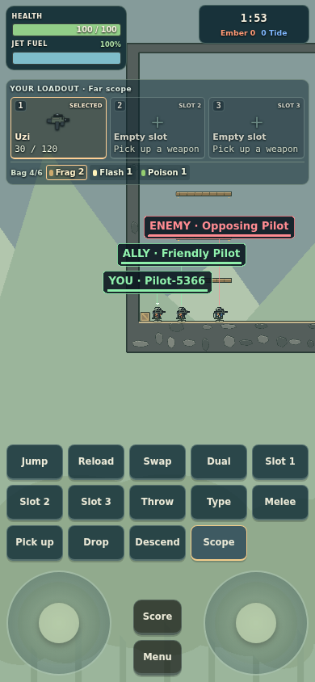
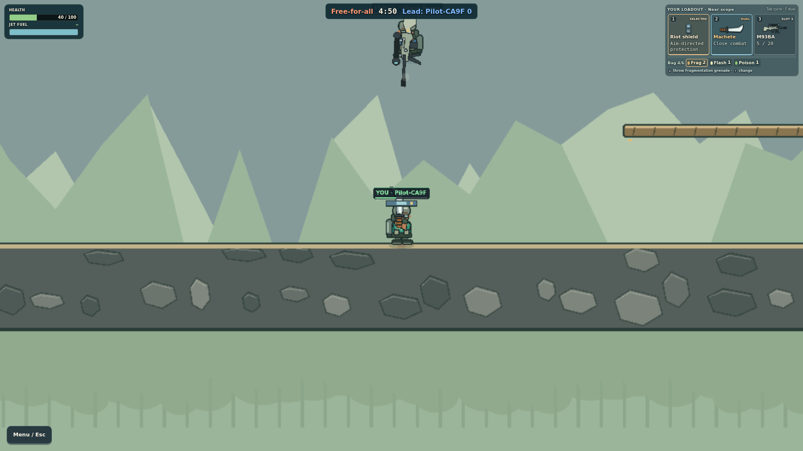

# How I built Jet Skirmish

## Finding the game I wanted

I started with the idea of a multiplayer shooter where friends could play in
teams or against each other. I thought about 3D games such as Valorant, PUBG and
Call of Duty. Then I remembered Mini Militia from my childhood. I wanted to
bring back that excitement while changing things that had disappointed me.
Choosing 2D gave me room to focus on flight, combat and teamwork without also
building a first-person world.

I made own-flag delivery central: carry our flag into their goal, protect the
carrier and recover it if it drops. I wanted a reason to cooperate beyond
adding our kills together. The initial
[c9a6d0b](https://github.com/comp4020-agentic-coding-studio/comp4020-final-adithya-rama/commit/c9a6d0b)
recorded online play, eight-player rooms and the flag contract. I use
[Sloan's small-software argument](https://www.robinsloan.com/notes/home-cooked-app/)
to explain why a game for a few friends is enough. The
[MDA framework](https://www.cs.northwestern.edu/~hunicke/MDA.pdf) helps me ask
whether the rules actually create the teamwork I want. Neither reading proves
that my game is enjoyable.

## Why this stack and workflow

I chose TypeScript, PixiJS, Node, WebSockets and SQLite; the
[stack record](docs/decisions/0001-stack.md) is part of
[c9a6d0b](https://github.com/comp4020-agentic-coding-studio/comp4020-final-adithya-rama/commit/c9a6d0b).
The course provided one shared CPU, 256 MB and a persistent volume. Sharing
movement code between browser and server reduced duplicated rules. Pixi draws
the arena while HTML handles menus. That gives me direct control, but also means
owning collision, prediction and input handling that a larger engine might supply.

WebSockets suit frequent two-way actions. The server decides damage and scores;
the client predicts movement to reduce the feeling of delay. Trusting each
browser would be simpler, but two players could disagree about the same shot.
SQLite fits the single machine without another database service. Its synchronous
API runs in a worker, adding coordination work to protect the game loop.
The cost of this small deployment is one active round and no live-match recovery
after restart. Completed results and partial checkpoints are different promises.

Claude built the first connected foundation in
[6f60466](https://github.com/comp4020-agentic-coding-studio/comp4020-final-adithya-rama/commit/6f60466),
with a handoff in [f868182](https://github.com/comp4020-agentic-coding-studio/comp4020-final-adithya-rama/commit/f868182). Those stages landed together; I cannot present them as a neat series of smaller commits. I then used Codex to review and had claude continue the work. Later tasks were split between simulation, server and visual work, with one integrator combining them. This let work proceed together, but shared types and assumptions still needed review. A second agent's approval was useful, not proof of correctness.

## Giving the agents something concrete

The first version ran, but it did not look or behave like the game in my head.
Maps felt repetitive, characters looked wrong, and flight, weapon reach and
damage needed work. My descriptions left too much open. I started supplying
map, character and gun images, gameplay documentation and explanations of what
to take from each reference.

Commit [015b103](https://github.com/comp4020-agentic-coding-studio/comp4020-final-adithya-rama/commit/015b103)
separated older v4, later Classic guides and my own choices before
[e05240a](https://github.com/comp4020-agentic-coding-studio/comp4020-final-adithya-rama/commit/e05240a)
changed the game. That matters: a remembered behaviour or a current wiki page
is not automatically evidence of how v4 worked. The research also corrected a
map label. I kept authored geometry and credited replacement audio instead of
claiming exact original assets. Clearer references helped the agents, but did
not remove the need to inspect what they produced.

## What watching people play changed

My [playtest record](docs/PLAYTEST.md) now connects my recollection to two saved
rounds on 21 October: five pilots in Outpost free-for-all, then four in Catacombs
team deathmatch. Their results survived until 5 November. That supports shared
play and persistence; it does not prove enjoyment or flag teamwork.

Across my peer playtests, people showed me problems I had stopped noticing. They struggled to acquire and switch weapons, tried to protect their heads with a shield that only faced sideways, expected rockets to cause more damage, and felt snipers were sometimes way too powerful. These observations gave me specific cases to explain to the agents, rather than another request to make the game better.

I also changed my own decisions. I initially wanted movement to help set aim;
later, moving left while shooting right made the problem obvious.
[0942d8f](https://github.com/comp4020-agentic-coding-studio/comp4020-final-adithya-rama/commit/0942d8f)
separated them and added keyboard, touch and browser regressions. Players losing
sight of their pilot beyond the map and an obstructive inventory led to
[0ffc831](https://github.com/comp4020-agentic-coding-studio/comp4020-final-adithya-rama/commit/0ffc831).
Difficulty telling teams apart led to readable ally/enemy labels in
[7bd1e35](https://github.com/comp4020-agentic-coding-studio/comp4020-final-adithya-rama/commit/7bd1e35).

*Automated live check, 21 October: explicit team labels remain separated at
phone Far scope. This verifies a correction; it is not a peer-playtest photo.*

My sniper correction went too far: I asked for lethal body shots in
[3463a0d](https://github.com/comp4020-agentic-coding-studio/comp4020-final-adithya-rama/commit/3463a0d),
then rejected that balance. [2a4b400](https://github.com/comp4020-agentic-coding-studio/comp4020-final-adithya-rama/commit/2a4b400)
restored two body hits and lethal exposed headshots, alongside directional
shield and blast tests. I should not describe every correction as the model
getting my instructions wrong. Sometimes my instructions were wrong for the
experience I wanted.

*Automated live check, 28 October: the overhead shot leaves health unchanged at
40 after an earlier body hit. The [evidence record](docs/evidence/README.md)
links both images to their checks and limitations.*

## Making corrections last

The strongest changes became checks. In
[225a493](https://github.com/comp4020-agentic-coding-studio/comp4020-final-adithya-rama/commit/225a493),
room tests protect reconnecting inventory, reject premature rematches after
storage failure and reserve capacity before asynchronous match creation.
The server/logging work in
[2c64cb3](https://github.com/comp4020-agentic-coding-studio/comp4020-final-adithya-rama/commit/2c64cb3)
checks ownership and makes rejected actions traceable to actual guests.

Passing tests still missed important things. A rocket breakup check did not
establish that normal grenades behaved consistently. A selectable hairstyle
was not necessarily good artwork. [1b8f02d](https://github.com/comp4020-agentic-coding-studio/comp4020-final-adithya-rama/commit/1b8f02d)
expanded explosive-cause tests and shared facial artwork between preview and
game. Browser checks then used actual throws and independent guests. I kept
human judgement separate from those results.

This rewrite also consolidates the current rules in [CLAUDE.md](https://github.com/comp4020-agentic-coding-studio/comp4020-final-adithya-rama/blob/main/CLAUDE.md) and a dated [quality contract](docs/QUALITY_CONTRACT.md).
It corrects an outdated controls guide and strengthens the check that the full
README reaches the running site. These are final-review improvements, not rules
I am pretending existed throughout development. See
[the final review record](docs/PORTFOLIO_REVIEW_2026_11_05.md).

## What I can stand behind

The acceptance record in [d171901](https://github.com/comp4020-agentic-coding-studio/comp4020-final-adithya-rama/commit/d171901)
records constrained container runs; [21406fb](https://github.com/comp4020-agentic-coding-studio/comp4020-final-adithya-rama/commit/21406fb)
records later live browser and persistence checks. Their dates and limits matter.
They do not prove every future change is safe. Peer feedback was informal; I did
not run a controlled usability study or measure improvement rates.

I wanted AI to help row the boat while I remain responsible for its direction. That also means listening when players show my direction needs changing. I have also preserved the three crit reflections as the record of what I understood then.
