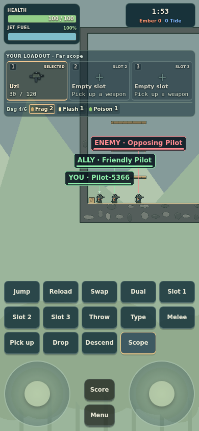
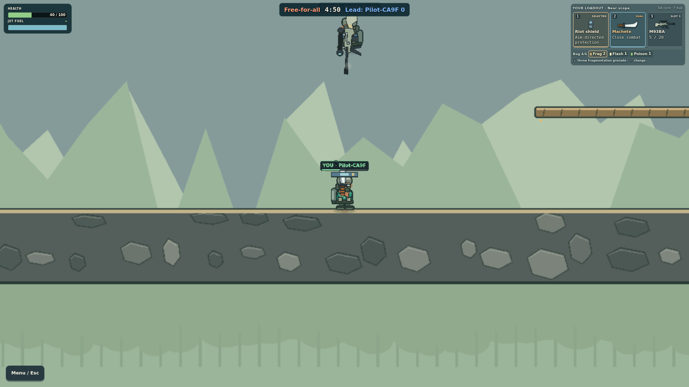

# Portfolio evidence: sources and limits

Compiled on 5 November 2026. These files preserve selected evidence rather than
requiring a marker to access ignored local test output. Human observations,
persisted match results and scripted browser checks have different meanings.

## Recovered peer-session results

[peer-playtest-2026-10-21.json](peer-playtest-2026-10-21.json) contains the two
production match results Adithya identified as sounding like his peers' session
around 11 am AEDT on 21 October. The extraction used read-only SQLite access on
5 November, selecting matches from the full local day before isolating the two
confirmed rounds in room Z9JXV.

The query selected match metadata and participant counters. It did not query
sessions, passwords or preferences. Names and profile identifiers are omitted;
Pilot A–E are aliases preserving only the identity relationship across these two
rounds. The full-day raw response remains in ignored local storage. The public
extract retains match IDs for traceability, but those IDs do not grant access to
a player's private history through the authenticated API.

Both rounds were completed at their five-minute limit. The same four profiles
participated in both. This supports repeat participation within the session and
persisted outcomes; it does not establish motivation, human headcount from
telemetry alone, intentional escort play or a next-day return by the peers.
The exact deployed commit was not stored with the matches. See
[the retrospective playtest account](../PLAYTEST.md) for observations and limits.

The log recovery examined 61 local log/capture files. No timestamped entry was
found in the 9 am–1 pm AEDT window. The saved Crit 10 live stream instead belongs
to the earlier automated rehearsal. The current Fly buffer contained 5 November
events. Match data supplied the usable evidence; no missing event transcript
has been reconstructed or fabricated.

## Phone team labels



- Original: `test-results/nameplates-live/390-Far.png`, copied byte-for-byte.
- Size: 390×844; 89,175 bytes.
- SHA-256 is recorded below.
- Source report: `test-results/nameplates-live/report.json`, 21 October at
  02:43 AEDT (`2026-10-20T15:43:26.601Z`), production Fly URL.
- Check: `scripts/browser-nameplates.ts`, one browser and two independently
  authenticated scripted guests. Assertions check visible ALLY/ENEMY text,
  viewer-relative colours, fixed text size and non-overlapping labels.
- Correction: [7bd1e35](https://github.com/comp4020-agentic-coding-studio/comp4020-final-adithya-rama/commit/7bd1e35);
  [design and validation record](../NAMEPLATE_VALIDATION.md). The raw report
  does not store a build hash, so the image is not described as independently
  proving which exact commit was deployed.

## Overhead shield



- Original: `test-results/directional-combat-live/shield-overhead.png`, copied
  byte-for-byte.
- Size: 1920×1080; 193,430 bytes.
- SHA-256 is recorded below.
- Source report: `test-results/directional-combat-live/report.json`, 28 October
  at 04:16 AEDT (`2026-10-27T17:16:09.135Z`), production Fly URL.
- Check: `scripts/browser-directional-combat.ts`, real keyboard input and an
  independently authenticated scripted attacker. An earlier exposed body shot
  reduced health from 100 to 40. The overhead shot was intercepted and left
  health at 40; both clients agreed. The screenshot shows orientation while
  the assertions establish the damage outcome.
- Correction: [2a4b400](https://github.com/comp4020-agentic-coding-studio/comp4020-final-adithya-rama/commit/2a4b400);
  [live acceptance record](../COMBAT_WORKSHOP_2026_10_28.md) links the release to
  deployment workflow 40548372485.

[Selected report excerpts](screenshot-check-excerpts.json) retain relevant
assertion values, source-report hashes and timestamps without unrelated actor
state. Both reports contain no recorded browser errors; the shield report has
no recorded failure. These are historical results, not fresh runs on 5 November.

These screenshots show corrected behaviour, not a matched before/after study.
They are not photographs of the peer session and do not establish enjoyment or
a successful same-participant retest.

## Image integrity

The copied files retain their original bytes. Hashes, in the same order as the
images above:

```text
74e44ce49def85cbe443d5ee56e7324fb100de550840ccf5ed8b820ce8178b63
3d58964ade1b558de8fe97212d4dc40be46c91877baff23f74f9e1df8ff1a3a0
```
